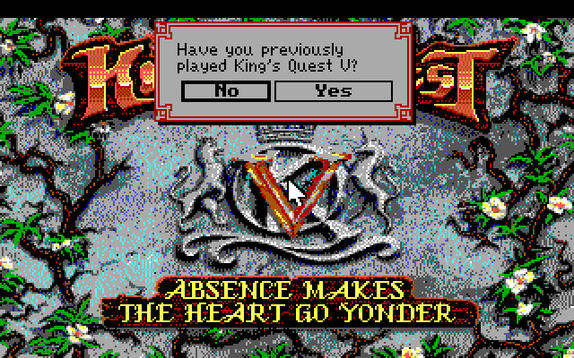

# King's Quest V for the Atari ST

An unofficial reconstruction of the Atari ST version of *King's Quest V: Absence Makes the Heart
Go Yonder!* that Sierra announced and then cancelled in 1991.



**Want to play?** Download the zip from [Releases](https://github.com/jarnalyrkar/KQ5ST/releases).
It holds a ready game folder for an Atari STE/ST hard disk, Hatari or Steem SSE, with
instructions in `READ_ME.TXT`.

## Why this project exists

Sierra On-Line announced an Atari ST version of King's Quest V in *Sierra News Magazine* for a
spring 1991 release. Sierra's Srini Vasan and Sierra UK pushed for continued Atari ST
development, but Sierra dropped Atari ST support entirely shortly afterwards and the port was
cancelled ([Wikipedia](https://en.wikipedia.org/wiki/King%27s_Quest_V)). According to
[Atarimania](https://www.atarimania.com/), the port was probably close to finished: the manual
even has loading instructions for the Atari ST. It was never released.

This project tries to give the ST the version it should have had. Sierra built its ST games
with the same SCI interpreter as its Amiga games, and the two machines share the 68000 CPU, so
the port takes the shipped Amiga version and makes it run on TOS:

- The Amiga interpreter (`Prog`) is converted hunk by hunk into a TOS program, with a few byte
  patches.
- A small **shim** stands in for the parts of AmigaOS and the Amiga hardware that the
  interpreter uses (exec, dos, graphics, the blitter, input, timers) on top of GEMDOS, XBIOS and
  the ST hardware.
- The **art** comes from the PC EGA version (16 colours, which matches the ST's 16-colour low
  resolution), merged into the Amiga resources so the Amiga game scripts still work.
- **Sound** goes through a new YM2149 driver that plays the music data the Amiga version
  shipped for 3-voice hardware.
- Small **script patches** fix speed, add a double-click to skip walking and mouse-only title
  skips, map the keypad as in the PC manual, and remove the copy protection (as in the later CD
  release).

It runs in Hatari (STE, TOS 1.62, 4 MB) and has been play-tested from the opening through the town,
the forest and the desert (oasis, temple, bandits' tent). See [`port/docs/HANDOFF.md`](port/docs/HANDOFF.md) for the current state and known gaps.

## What is in this repository

The repository holds **only the project's own work**: the shim, the patches, the tools and the
documentation. The original games, the generated game folder and other projects' code are not
included (see `.gitignore`).

| Path | Contents |
|---|---|
| [`port/docs/`](port/docs/README.md) | Development notes, split by area. **Start with [`port/docs/README.md`](port/docs/README.md).** They cover how the interpreter is mapped onto TOS (`ARCHITECTURE.md`), art and screen (`GRAPHICS.md`), input (`INPUT.md`), game-script patches (`SCRIPTS.md`), the YM2149 sound driver (`SOUND.md`), a map of the Amiga interpreter (`AMIGA_PROG.md`) and how to build, test and debug (`WORKFLOW.md`). |
| [`port/st/src/`](port/st/src) | The TOS shim in C and 68000 assembly: AmigaOS libraries (`exec.c`, `dos.c`, `memory.c`), display and blitter (`display.c`, `blit.c`, `blitter.c`), IKBD input (`input.c`), YM2149 sound (`ym.c`), startup and trap glue (`glue.S`). |
| [`port/st/patches/prog.patch`](port/st/patches/prog.patch) | Byte patches applied to the Amiga interpreter during the build, with comments. |
| `port/st/build.sh`, `play.sh`, `run.sh` | Build `KQ5ST.PRG`; play in Hatari; headless test runs. |
| [`port/st/tests/`](port/st/tests) | Autoplay scripts for headless Hatari runs. |
| [`port/tools/`](port/tools) | Python tools: Amiga disk and hunk-file readers, a relocation-aware 68000 disassembler, an SCI resource extractor and script disassembler, picture/view converters, the art, script and sound patch builders, and the release packer. See [`port/README.md`](port/README.md). |

## Building from your own copy

You need the Amiga release of King's Quest V (version 1.000.000, eight ADF disk images) and the
PC EGA floppy release (version 0.000.055, disk images 1–9; the tenth image in some sets carries
a different `RESOURCE.MAP` and must be left out). Tools needed: Python 3 with
`Pillow` and `capstone`, `7z`, an m68k cross toolchain (`m68k-linux-gnu-gcc` and binutils;
`build.sh` sources `~/.local/opt/m68k-gcc/env.sh`, so edit that line for your setup) and
[Hatari](https://www.hatari-emu.org/) to run it. From `port/`:

```sh
# 1. Unpack the originals
for i in 0 1 2 3 4 5 6 7; do python3 -I tools/adf.py ".../KQ5_Disk$i.adf" extracted/amiga_files/d$i; done
for f in .../dos/disk0[1-9].img; do 7z x -y -oextracted/dos_files "$f"; done   # not disk 10
python3 -I tools/sciextract.py extracted/amiga_files extracted/res_amiga
python3 -I tools/sciextract.py extracted/dos_files  extracted/res_dos
python3 -I tools/colourmap.py extracted/res_dos extracted/res_amiga extracted/amiga_files/d0/spal

# 2. Split and disassemble the Amiga interpreter (the docs refer to work/prog/disasm/hunkNN.s)
python3 -I tools/hunks.py extracted/amiga_files/d0/Prog work/prog
python3 -I tools/disasm.py work/prog work/prog/disasm

# 3. Game folder: the Amiga files, then the ST art, script and sound patch files
mkdir -p st/hd
cp extracted/amiga_files/d0/{RESOURCE.MAP,RESOURCE.000,resource.cfg,amiga3v.drv,amigasnd.drv,spal,version,756.SCR,756.TEX,9.pat} st/hd/
for i in 1 2 3 4 5 6 7; do cp extracted/amiga_files/d$i/RESOURCE.00$i st/hd/; done
python3 -I tools/makest.py st/hd
python3 -I tools/makescr.py st/hd
python3 -I tools/makesnd.py st/hd

# 4. Build KQ5ST.PRG and play
st/build.sh
st/play.sh
```

`tools/mkrelease.sh VERSION` packs `st/hd` into `dist/KQ5ST-VERSION.zip` for a release.

The decompiled Amiga game scripts that the docs refer to (`amiga-decompiled/`, next to `port/`)
are sluicebox's [`sci-scripts`](https://github.com/sluicebox/sci-scripts) folder
`kq5-amiga-1.000.000`.

## Copyright and licences

**King's Quest V is © 1990 Sierra On-Line, Inc.** The rights now belong to Activision
(Microsoft). This is a non-commercial fan project, not affiliated with or endorsed by Sierra,
Activision or Microsoft. If you enjoy the game, buy it (it is sold on GOG and Steam).

Copyrighted by Sierra and **not** covered by this project's licence:

- **The game data**: the `RESOURCE.*` files, `amiga3v.drv`, `amigasnd.drv`, `756.SCR`,
  `756.TEX`, `9.pat`, `spal`, `version` and `resource.cfg` in the release zip are copied
  unchanged from the Amiga release.
- **The interpreter**: `KQ5ST.PRG` in the release zip contains Sierra's Amiga interpreter `Prog`,
  converted and patched, linked with the project's shim.
- **The ST art, scripts and sounds**: the `N.p32`, `N.v32`, `N.SCR` and `N.snd` files in the
  release zip are Sierra's artwork, game scripts and music, converted or patched by the tools.
- **Excerpts in this repository**: `port/st/patches/prog.patch` quotes a few original bytes of
  `Prog` (to check that each patch hits the right place); `port/tools/makescr.py` and
  `port/tools/makesnd.py` quote short bytecode and sound-data sequences; the docs cite addresses,
  names and behaviour of the original program.

The project's own code (everything in this repository: shim, patches, tools, scripts and docs) is
licensed under the **GNU General Public License v3.0 or later** ([`LICENSE`](LICENSE)). Some
tools port logic from ScummVM's SCI engine (below), which is GPLv3+ as well.

## Built with

The project could not have been done without these:

- **[ScummVM](https://www.scummvm.org/)** (GPLv3+): its SCI engine was the reference for the
  resource formats, picture and view decoding and the interpreter's behaviour.
  `tools/sciextract.py`, `tools/scipic.py` and parts of `tools/sciview.py` port its logic.
- **[sluicebox/sci-scripts](https://github.com/sluicebox/sci-scripts)**: decompiled SCI source
  of the Sierra games, used to understand what each room and object does before patching it.
- **[Hatari](https://www.hatari-emu.org/)** (GPLv2+): the Atari ST/STE emulator used for all
  testing, including its debugger, profiler, NatFeats debug output and GEMDOS hard-disk
  emulation.
- **[Steem SSE](https://sourceforge.net/projects/steemsse/)**: Atari ST emulator.
- **[Capstone](https://www.capstone-engine.org/)** (BSD): the 68000 disassembly in
  `tools/disasm.py`.
- **[GCC and GNU Binutils](https://www.gnu.org/)** (GPL): the m68k cross compiler, assembler and
  linker that build `KQ5ST.PRG`.
- **[Python](https://www.python.org/)** and **[Pillow](https://python-pillow.org/)**: all tools
  and image work.
- **[SoX](https://sourceforge.net/projects/sox/)** and **[FFmpeg](https://ffmpeg.org/)**:
  recording and listening to sound output.

The development was done together with Claude (Anthropic), an AI assistant.
